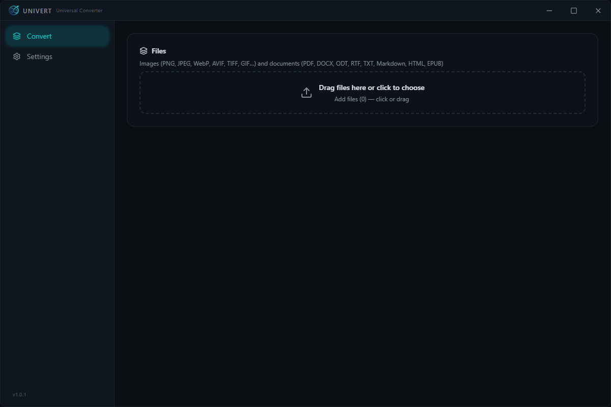
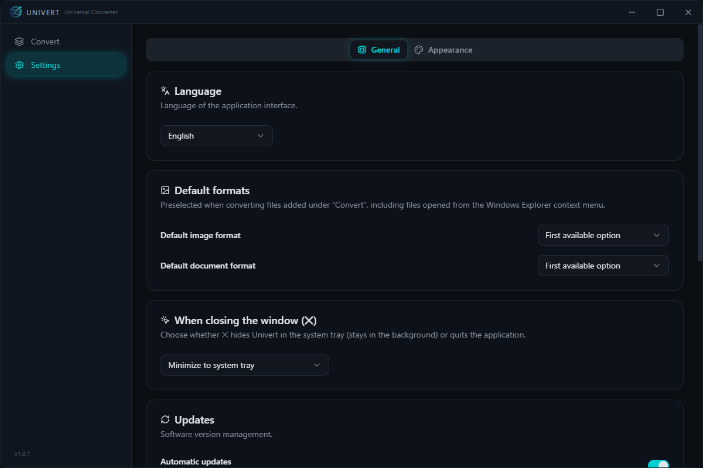

<p align="center">

</p>

# Universal Converter

[Español](README.es.md) | English

Conversor universal de imágenes y documentos de escritorio. Frontend en React +
Electron; las conversiones corren en local, empaquetadas con la app — no se
requiere software de terceros instalado para los formatos principales.

## Funcionalidad

- **Sección Convertir unificada** para imágenes *y* documentos: agrega 1 o N
  archivos (incluso mezclados) y conviértelos de una sola vez, con **formato por
  archivo**.
- **Conversión a PDF**: cualquier documento de texto/marcado u ofimática
  (MD, HTML, TXT, RTF, DOCX, ODT, EPUB) puede convertirse **a PDF** con el
  **motor PDF** opcional (~32 MB, autodescarga desde Ajustes, sin permisos de
  administrador).
- **Menú contextual del Explorador de Windows**: «Convertir con Univert» sobre
  imágenes y documentos compatibles; las selecciones múltiples se fusionan en
  una sola ventana con los **formatos por defecto** preseleccionados.
- **Formatos por defecto** (imagen y documento) en Ajustes: se preseleccionan
  al agregar archivos a convertir, incluidos los del menú contextual.
- **Drag & drop global**, muestra la ruta origen, convierte **por defecto junto
  al archivo de origen** con opción de un directorio de salida distinto, y
  **calidad 0–100%** donde la admiten.
- **Comportamiento de cierre**: la ✕ oculta Univert en la **bandeja del
  sistema** (por defecto) o cierra la aplicación — tú eliges en Ajustes.
- **Actualizaciones automáticas** desde GitHub Releases con **barra de
  descarga** dentro de la app sobre la etiqueta de versión.
- Interfaz oscura con animaciones y ajuste en vivo de **transparencia, color y
  blur** de la ventana.

## Capturas

<p align="center">
  
  <br><br>
  
</p>

## Motores: qué incluye la app y qué puedes agregar desde Ajustes

Toda la matriz de formatos de abajo funciona desde el primer arranque para los
formatos principales. La cobertura extra es una **autodescarga opcional** desde
**Ajustes → Motores de conversión** (con barra de progreso y sin reiniciar):

| Motor | Habilita | Disponibilidad |
|---|---|---|
| Pandoc | Conversiones MD, HTML, TXT, RTF, DOCX, ODT, EPUB | **Incluido** en el instalador |
| ImageMagick | Formatos raros de imagen (HEIC, RAW, ICO, PSD) | **Incluido** |
| Ghostscript | PDF → PNG (rasterizado de páginas) | Descarga opcional (~30 MB) |
| **Motor PDF (wkhtmltopdf)** | **«Convertir a PDF» desde cualquier documento** | Descarga opcional (~32 MB, sin admin) |
| LibreOffice | Ofimática completa (XLSX, PPTX, PDF con formato) | Descarga opcional (~350 MB, una confirmación UAC) |

Si falta un motor, la conversión afectada **no ofrece ese destino** o devuelve
un error claro (`MOTOR_MISSING`), y el resto de la app sigue funcionando. En
**Ajustes** se muestra el estado de cada motor.

## Desarrollo

```bash
npm install
npm run dev        # arranca con HMR
npm run build      # compila main/preload/renderer a out/
npm run typecheck  # tsc en main/preload y renderer
```

### Verificaciones del motor

```bash
npm run verify:images   # matriz de conversión de imágenes, dimensiones, calidad, rutas
npm run verify:docs     # operaciones PDF, documento→PDF y degradación de motores
npm run verify:batch    # cola de lotes, formatos por archivo, cancelación
npm run verify:ctxmenu  # plan del menú contextual, alta/baja en caliente, parser de argv
```

### Empaquetar (Windows)

```bash
npm run dist:win   # instalador NSIS + portable + zip
```

## Matriz de formatos (real, verificada)

`npm run verify:images` valida la columna de imágenes en cada build.

### Imágenes — motor `sharp`/`resvg`, incluido en la app (sin binarios)

| Origen ↓ / Destino → | PNG | JPEG | WebP | AVIF | TIFF | GIF | BMP |
|---|---|---|---|---|---|---|---|
| PNG | — | ✓ | ✓ | ✓ | ✓ | ✓ | ✓ |
| JPEG | ✓ | — | ✓ | ✓ | ✓ | ✓ | ✓ |
| WebP | ✓ | ✓ | — | ✓ | ✓ | ✓ | ✓ |
| AVIF | ✓ | ✓ | ✓ | — | ✓ | ✓ | ✓ |
| TIFF | ✓ | ✓ | ✓ | ✓ | — | ✓ | ✓ |
| GIF | ✓ | ✓ | ✓ | ✓ | ✓ | — | ✓ |
| BMP | ✓ | ✓ | ✓ | ✓ | ✓ | ✓ | — |
| SVG | ✓ (resvg) | ✓ | ✓ | ✓ | ✓ | ✓ | ✓ |

- **Calidad 0–100%** aplicable en PNG, JPEG, WebP, AVIF, TIFF y GIF (el slider
  se oculta en BMP, sin parámetro de calidad).
- **SVG** se rasteriza con `resvg` (WASM/Rust, sin binarios del sistema). SVG
  como formato de *salida* vectorial no está soportado en esta fase
  (limitación documentada; requiere un trazador vectorial).

### Imágenes raras — ImageMagick (incluido)

HEIC/HEIF, RAW (CR2/NEF/DNG), ICO, PSD. Ver `resources/bin/README.md`.

### Documentos

| Operación | Motor | Disponibilidad |
|---|---|---|
| Unir PDF | `pdf-lib` | **Incluido** (sin instalar nada) |
| Partir PDF | `pdf-lib` | **Incluido** (sin instalar nada) |
| MD ↔ HTML ↔ TXT ↔ RTF ↔ DOCX ↔ ODT ↔ EPUB | Pandoc | **Incluido** |
| **Cualquiera de los anteriores → PDF** | Pandoc + **motor PDF (wkhtmltopdf)** | Descarga opcional (Ajustes) |
| PDF → PNG (rasterizar páginas) | Ghostscript | Descarga opcional (Ajustes) |
| XLSX, PPTX, PDF con formato | LibreOffice headless | Descarga opcional (Ajustes) |

## Arquitectura

- `src/main/` — proceso principal de Electron: ventana, bandeja, IPC y motores
  (`imageConverter.ts`, `docConverter.ts`, `batchProcessor.ts`, `binaries.ts`,
  `engineInstaller.ts`, `contextMenu.ts`).
- `src/preload/` — puente `contextBridge` con `window.api` tipado.
- `src/renderer/` — UI React (secciones Convertir y Ajustes).
- `src/shared/` — tipos compartidos entre los tres procesos.

Toda conversión corre en el **proceso main**; el renderer solo habla por IPC. Los
binarios externos se ejecutan como procesos hijo con `execFile` (sin shell) y
límites de tiempo.

## Actualizaciones y donaciones

- La app busca nuevas versiones en **GitHub Releases** y las instala desde
  Ajustes → Actualizaciones (descarga en segundo plano, barra de progreso en la
  app y aviso cuando está lista).
- [docs/RELEASE.md](docs/RELEASE.md) — cómo publicar una versión.
- [docs/SETUP-NEW-APP.md](docs/SETUP-NEW-APP.md) — cómo replicar el modelo en
  cada nuevo proyecto de software de la organización.
- [docs/DONACIONES.md](docs/DONACIONES.md) — plataformas de donación
  recomendadas desde Argentina (GitHub Sponsors + Mercado Pago + Ko-fi).

## Donaciones

Estoy desarrollando varios softwares mas que intentan facilitar la vida diaria
de cada uno. Todos los softwares en desarrollo serán gratuitos. La donación es
la verdadera forma de que cada moneda que recibe el desarrollador es por que
realmente se lo merece por ser de manera voluntaria. GRACIAS!

[](https://ko-fi.com/friezasama)BUY ME A COFFEE

## Licencias de binarios redistribuidos

Si empaquetas los binarios opcionales en `resources/bin`, incluye sus
licencias:

- ImageMagick: https://imagemagick.org/license/ (requiere atribución).
- Pandoc: GPL-2. Ghostscript: AGPL. LibreOffice: MPL-2.0. wkhtmltopdf: LGPL-3.
