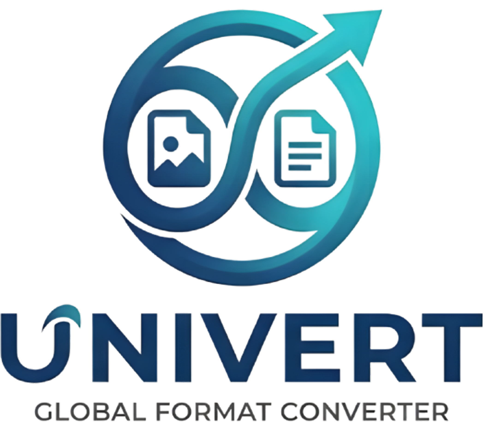

<p align="center">

</p>

# Universal Converter

English | [Español](README.es.md)

Desktop universal image and document converter. React + Electron frontend;
conversions run locally, bundled with the app — no third-party software
required for the main formats.

## Features

- **One unified Convert section** for images *and* documents: add 1 or N files
  (even mixed) and convert them in one go, with a **format per file**.
- **Convert to PDF**: any text/markup or office document (MD, HTML, TXT, RTF,
  DOCX, ODT, EPUB) can be converted **to PDF** with the optional **PDF engine**
  (~32 MB self-download from Settings, no admin rights).
- **Windows Explorer context menu**: “Convert with Univert” on compatible
  images and documents; multi-selections are merged into a single window with
  the **default formats** preselected.
- **Default formats** (image and document) in Settings: preselected whenever
  files are added to convert, including from the context menu.
- **Global drag & drop**, source path shown, conversion **next to the source
  file by default** with the option of a different output directory, and
  **quality 0–100%** where supported.
- **Close behavior**: the ✕ hides Univert in the **system tray** (default) or
  quits the app — your choice in Settings.
- **Automatic updates** from GitHub Releases with an in-app **download bar**
  shown over the version label.
- Dark-themed UI with animations and live **transparency, color and blur**
  adjustment.

## Engines: what's included and what you can add yourself

Everything in the format matrix below works out of the box for the main
formats. Extra coverage is an **optional self-download** from
**Settings → Conversion engines** (progress bar included, applied without
restarting):

| Engine | Enables | Availability |
|---|---|---|
| Pandoc | MD, HTML, TXT, RTF, DOCX, ODT, EPUB conversions | **Bundled** in the installer |
| ImageMagick | Rare image formats (HEIC, RAW, ICO, PSD) | **Bundled** |
| Ghostscript | PDF → PNG (page rasterization) | Optional download (~30 MB) |
| **PDF engine (wkhtmltopdf)** | **“Convert to PDF” from any document** | Optional download (~32 MB, no admin) |
| LibreOffice | Full office suite (XLSX, PPTX, formatted PDF) | Optional download (~350 MB, one UAC prompt) |

If an engine is missing, the affected conversion either **doesn't offer that
target** or returns a clear `MOTOR_MISSING` error, and the rest of the app
keeps working. Settings shows the live status of every engine.

## Development

```bash
npm install
npm run dev        # starts with HMR
npm run build      # compiles main/preload/renderer to out/
npm run typecheck  # tsc for main/preload and renderer
```

### Engine checks

```bash
npm run verify:images   # image conversion matrix, dimensions, quality, routes
npm run verify:docs     # PDF operations, document→PDF and engine degradation
npm run verify:batch    # batch queue, per-file formats, cancellation
npm run verify:ctxmenu  # Explorer context menu plan, hot sync, argv parsing
```

### Packaging (Windows)

```bash
npm run dist:win   # NSIS installer + portable + zip
```

## Format matrix (real, verified)

`npm run verify:images` validates the images column on every build.

### Images — `sharp`/`resvg` engine, bundled with the app (no external binaries)

| Source ↓ / Target → | PNG | JPEG | WebP | AVIF | TIFF | GIF | BMP |
|---|---|---|---|---|---|---|---|
| PNG | — | ✓ | ✓ | ✓ | ✓ | ✓ | ✓ |
| JPEG | ✓ | — | ✓ | ✓ | ✓ | ✓ | ✓ |
| WebP | ✓ | ✓ | — | ✓ | ✓ | ✓ | ✓ |
| AVIF | ✓ | ✓ | ✓ | — | ✓ | ✓ | ✓ |
| TIFF | ✓ | ✓ | ✓ | ✓ | — | ✓ | ✓ |
| GIF | ✓ | ✓ | ✓ | ✓ | ✓ | — | ✓ |
| BMP | ✓ | ✓ | ✓ | ✓ | ✓ | ✓ | — |
| SVG | ✓ (resvg) | ✓ | ✓ | ✓ | ✓ | ✓ | ✓ |

- **Quality 0–100%** applies to PNG, JPEG, WebP, AVIF, TIFF and GIF (the slider
  is hidden for BMP, which has no quality parameter).
- **SVG** is rasterized with `resvg` (WASM/Rust, no system binaries). SVG as a
  vector *output* format is not supported in this phase (documented limitation;
  it requires a vector tracer).

### Rare images — ImageMagick (bundled)

HEIC/HEIF, RAW (CR2/NEF/DNG), ICO, PSD. See `resources/bin/README.md`.

### Documents

| Operation | Engine | Availability |
|---|---|---|
| Merge PDF | `pdf-lib` | **Included** (no install needed) |
| Split PDF | `pdf-lib` | **Included** (no install needed) |
| MD ↔ HTML ↔ TXT ↔ RTF ↔ DOCX ↔ ODT ↔ EPUB | Pandoc | **Bundled** |
| **Any of the above → PDF** | Pandoc + **PDF engine (wkhtmltopdf)** | Optional download (Settings) |
| PDF → PNG (rasterize pages) | Ghostscript | Optional download (Settings) |
| XLSX, PPTX, formatted PDF | LibreOffice headless | Optional download (Settings) |

## Architecture

- `src/main/` — Electron main process: window, tray, IPC and engines
  (`imageConverter.ts`, `docConverter.ts`, `batchProcessor.ts`, `binaries.ts`,
  `engineInstaller.ts`, `contextMenu.ts`).
- `src/preload/` — typed `contextBridge` bridge exposing `window.api`.
- `src/renderer/` — React UI (Convert and Settings sections).
- `src/shared/` — types shared across the three processes.

All conversion runs in the **main process**; the renderer only talks over IPC.
External binaries are executed as child processes with `execFile` (no shell)
and timeouts.

## Updates and donations

- The app checks for new versions on **GitHub Releases** and installs them from
  Settings → Updates (background download, in-app progress bar and notification
  when ready).
- [docs/RELEASE.md](docs/RELEASE.md) — how to publish a version.
- [docs/SETUP-NEW-APP.md](docs/SETUP-NEW-APP.md) — how to replicate the model in
  each new software project of the organization.
- [docs/DONACIONES.md](docs/DONACIONES.md) — recommended donation platforms from
  Argentina (GitHub Sponsors + Mercado Pago + Ko-fi).

## Donations

I am developing several more pieces of software that try to make everyone's
daily life easier. Every software under development will be free. Donating is
the real way for every coin the developer receives to be because they truly
deserve it, given voluntarily. THANK YOU!

[](https://ko-fi.com/friezasama) BUY ME A COFFEE

## Redistributed binary licenses

If you package the optional binaries in `resources/bin`, include their
licenses:

- ImageMagick: https://imagemagick.org/license/ (attribution required).
- Pandoc: GPL-2. Ghostscript: AGPL. LibreOffice: MPL-2.0. wkhtmltopdf: LGPL-3.
